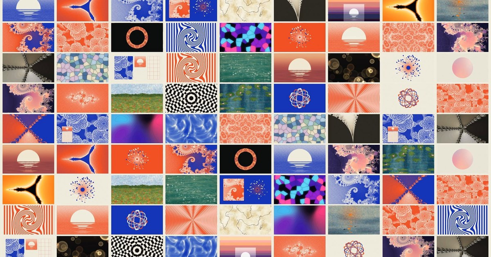

# monet



**Try it in the browser: [monet.hunterharloff.com](https://monet.hunterharloff.com)**

A shader REPL for making beautiful designs live, written in Rust.
Live coding for light: a picture, then effects,
chained with `.`. It re-evaluates on every keystroke.

```js
mesh("dawn")                 // a picture
  .flow(.25)                 // effects chain with `.`
  .dither("riviera", 4)
glints().blend("add")        // each line is a layer, bottom first
```

```bash
cargo run --release                 # the editor
cargo run --release -- my.monet     # edit a file (hot-reloads if changed elsewhere)
```

## In the browser

**[monet.hunterharloff.com](https://monet.hunterharloff.com)** runs the same Rust
engine, compiled to WebAssembly (with SIMD) and drawing with WebGPU. Browsers
without WebGPU fall back to WebGL2, where naga translates every shader to GLSL ES.
Everything in the editor works the same, with a few differences:

- Sketches save in the browser.
- ⌘S downloads the `.monet` file.
- ⌘E downloads a PNG.
- **share** (⌘⇧C) copies a link with the sketch inside it, so whoever opens it sees exactly what you made.
- `image()` needs the desktop app, because it reads files.
- On a phone the picture sits above the code; tap the picture to bring back its controls, and **focus** shows the picture alone.

```bash
web/build.sh     # → web/dist (release wasm, wasm-bindgen, wasm-opt -O3)
web/deploy.sh    # build, then ship to Vercel
python3 -m http.server -d web/dist   # try it locally; add ?gl to force WebGL2
```

## Writing sketches

**Pictures and effects.** Every argument has a curated default, so `mesh()`
alone already looks good.

**Patterns.** Any number can instead be a mini-notation
string. Steps glide into each other, and the step that is playing lights up in
the code.

```js
radial("<dawn ember lagoon>")       // palettes alternate per cycle, crossfading
  .zoom("1 1.4 1.15 2")             // a sequence: four steps per cycle
  .ripple("0 .4 [.2 .8]", 8)        // brackets nest
  .kaleido("<6 8 5>")
```

| pattern | meaning |
|---|---|
| `"0 .5 1"` | a sequence: each value gets an equal slice of the cycle |
| `"<a b c>"` | one per cycle |
| `"[0 1] 2"` | nesting |
| `"0*2"` `"0/2"` | faster · slower |
| `"1@3 0"` | weight (¾ and ¼) |
| `"1!3 0"` | replicate |
| `"1 ~"` | rest (0) |
| `"x/2"` | a whole pattern stretched over two cycles |

Put `.smooth()` after a pattern to glide across each whole step, or `.sharp()`
to jump between steps.

**Signals** are 0..1 waves on the cycle clock, and work anywhere a number does:
`sine` `cosine` `saw` `isaw` `tri` `square` `rand` `perlin` `mouse.x` `mouse.y`
`time`. Shape them with `.range(lo, hi)` `.slow(n)` `.fast(n)` `.early(c)`
`.late(c)` `.segment(n)` `.add` `.sub` `.mul` `.div`, or with `+ - * /`:

```js
julia("lagoon", sine.range(-.82, -.7).slow(8), .156)
```

**Pictures as arguments.** Some effects take another picture, with its own
chain, as an input:

```js
caustics("lagoon")
  .displace(spot(.2).trail(.97).blur(.5), .8)   // stir the water with the mouse
stripes("citrus").mask(spot(.3).blur(.4))        // reveal through a soft spot
gradient("dusk", 75).displace(clouds("mono", 3)) // brushed sand
```

`displace` bends the picture along the other picture's slopes: spots become
lenses and clouds become flow. `mask` uses the other picture's brightness.

**Names and settings.**

| | |
|---|---|
| `amt = slider(.3, 0, 1)` | a live slider in the sliders card; dragging it rewrites the number in the code |
| `p = "#f4a7b9 #fbe7d3 #a8c8f0"` | a palette of your own; use it as `mesh(p)` or `"<p dawn>"` |
| `speed(1)` | cycles per second (default 0.5) |
| `view(x, y, zoom)` | where fractals start |
| `stack(a, b)` | layers in one expression (bottom first) |

## Painting like Monet

`brush` turns any picture into impressionist strokes. It uses three layers,
large strokes first and fine ones on top. Each stroke follows the contours
beneath it, carries its own small shift of tone and hue (broken colour), and
has bristle texture. `canvas` adds a linen weave.

```js
lilies("giverny").brush(.9, .3).canvas(.6)       // Nymphéas
poppies("poppy").brush(1, .3).canvas(.6)         // Coquelicots
sunrise("harbour").brush(.8, .2, 0).canvas(.6)   // Impression, Sunrise: level strokes
mesh("rouen").brush(.8, .6)                      // anything can be painted
```

`brush(size, chaos, angle)`: `chaos` lets strokes wander off the contours, and
`angle` is the direction they lie in flat areas (0 = level).

The scenes `lilies`, `poppies` and `sunrise` read their palettes in a fixed stop
order, documented in the reference panel (for example lilies: deep water, mid
water, reflection, sky, pad dark, pad light, blossom, blossom light). Copy
`giverny`, `poppy` or `harbour` and change the colours to repaint them.

## Print and poster layouts

`stipple` is the grain of a riso print or an engraving. Each pixel becomes one
ink or another, chosen by a fixed random threshold. With a two-colour palette
(ink first, paper last) you get a duotone print. Add more stops for more inks.
`.place(x, y, w, h, radius, border)` puts any picture in a rounded card
anywhere on the canvas. Positions are fractions of the screen from the
lower-left, and the picture is drawn for the card's own shape rather than
stretched.

```js
peonies("mono").stipple("cobalt", 1, 1.25)                       // engraved peonies, riso blue
sun("mono", .2).place(.1, .42, .2, .16, .012).stipple("vermilion") // a card with a sunset
grid("graph", 8).place(.1, .04, .2, .37, .012, 2)                // graph paper, 2px border
image("photo.jpg").stipple("riso")                               // any photo, in two inks
```

Put `.stipple()` after `.place()` so the grain stays at screen resolution.

## Writing your own shaders

When the catalog doesn't have it, write it. A `picture` or an `effect` is native
WGSL inside the sketch, and from then on it works like any built-in. It chains
with `.`, takes patterns and signals, gets sliders, and shows up in autocomplete,
hover and the reference with the comment above it as its docs.

```js
// rings from three drifting points, meeting and crossing
picture tide(colors = "monet", waves = 3) {
    let p = asp(uv);
    var h = 0.0;
    for (var i = 0; i < 3; i++) {
        let a = f32(i) * 2.1 + u.time * 0.3;
        h += sin(length(p - vec2f(cos(a), sin(a)) * 0.35) * waves * TAU - u.time * 2.0);
    }
    return vec4f(pal(colors, h / 6.0 + 0.5), 1.0);
}

// reeded glass: each rib shows the picture a little shifted
effect pane(amount = .04, count = 16) {
    let x = fract(uv.x * count);
    return pic(uv + vec2f((x - 0.5) * amount, 0.0));
}

tide("<monet dawn>", sine.range(2, 4)).pane().grain(.03)
```

- **A picture** returns the colour at `uv` as a `vec4f`. `uv` runs 0 to 1 across the frame with y up; `asp(uv)` is centred and aspect-correct.
- **An effect** returns the new colour at `uv`. It reads the picture so far with `pic(p)` at any position, so the same form covers colour effects (`pic(uv).rgb * 2.0`) and warps (`pic(uv + offset)`).
- **Parameters** take their type from their default:
  - a number (or no default, which means 0) is an `f32`, fed by numbers, patterns, signals and sliders
  - a palette, like `colors = "dawn"`, is read with `pal(colors, t)` and `palc(colors, i)`; patterns like `"<dawn ember>"` crossfade
  - a picture, like `other = clouds()`, is called like a function, `other(uv)`; pass any picture with its own chain
- **The frame** is `u`: `u.time` in seconds, `u.cycle` (what patterns follow), `u.mouse`, `u.res`, `u.dt` and `u.frame`. A shader that never reads the clock is drawn once and then left alone, like built-in still pictures.
- **monet's library** is there too: `noise`, `fbm`, `voronoi`, `hash21`, `rot`, `luma`, OKLab conversion, `PI` and `TAU`. The reference (⌘K) lists everything under *Inside a shader*.
- **Helpers** go in a `wgsl { … }` block, and every shader in the sketch can call them.
- **Mistakes** are underlined where you made them. Each shader is checked with naga as you type, even before it's used, and the message is translated where it helps: `time` points you to `u.time`, and returning a `vec3f` reminds you to return `vec4f(rgb, 1.0)`.
- **Inside a block**, autocomplete offers WGSL, the library, `u.` fields, the shader's parameters, locals declared above and your helpers. Hover any of them for its signature.

The `shader` preset is a working example to start from.

## The catalog

**Pictures:** `solid` `gradient` `radial` `conic` `mesh` `blobs` `clouds` (fractal noise, like Photoshop's Clouds) `silk` `waves`
`aurora` `water` `caustics` `topo` `marble` `bokeh` `cells` `plasma` `rings` `stripes`
`checker` `dots` `tunnel` `stars` `glints` `spot` (follows the mouse)
`image("photo.png")`

**Monet scenes:** `lilies` `poppies` `sunrise`

**Print:** `peonies` (engraving-shaded blooms, made for `stipple`) `sun` (a sun
on the horizon) `grid` (graph paper)

**Graphic:** `orbits` (hand-drawn atom orbits) `rays` (an ink starburst with dots).
Both are transparent between their lines, so layer them over something.

**Fractals:**
- `mandelbrot(palette, iters, power, density)`: power above 2 gives multibrots, and edges get a distance-estimate glow
- `julia` `ship` `tricorn` `kali` `newton`
- Drag to pan, scroll to zoom, and set the start with `view(x, y, zoom)`.
- `.dive(speed, depth)` zooms endlessly into the view's centre.
- Antialiasing follows the real on-screen pixel size, so fractals stay sharp under `zoom`, `dive`, `kaleido` and every other effect.

**Shape and motion** (move where the picture is looked up): `zoom` `rotate` `spin`
`move` `scroll` `warp` `flow` `swirl` `ripple` `wave` `kaleido` `mirror` `tile`
`pixelate` `lens` (follows the mouse) `polar` `dive` `displace(picture)` `reeded`
(fluted glass) `glass` (faceted cells) `shuffle` (swap tiles; reshuffles every
1/rate cycles) `droste` (the picture inside itself) `place` (a rounded card,
anywhere)

**Colour and texture:** `hue` `saturate` `contrast` `brightness` `invert` `tint` `map`
(gradient map) `posterize` `dither(levels | palette, size, spread)` `halftone`
`ascii` `scanlines` `grain` (moving film grain) `noise` (see below) `vignette`
`contour` (isolines) `duotone` `canvas` `stipple` (riso and engraving grain)
`mask(circle | box | ring | diamond | blob | picture)` `opacity`

**Noise**, like Photoshop's *Add Noise*:
`.noise(amount, color, size, motion, "gaussian" | "uniform")`

```js
mesh("dawn").noise(.12)                       // colour noise, still: Photoshop's defaults
peonies("mono").noise(.2, 0)                  // monochromatic
sunrise("harbour").noise(.15, .3, 2, 1)       // bigger, mostly grey grain that moves like film
gradient("dusk").noise(.3, 1, 1, 0, "uniform") // Photoshop's Uniform distribution
```

- `amount`: strength. Uniform noise spans ±amount; gaussian has σ = amount / 2.
- `color`: 1 is colour noise, 0 is Photoshop's *Monochromatic*, and values between blend.
- `size`: grain size in pixels. Bigger grain keeps the same strength.
- `motion`: 0 holds still (and a still picture stays free to draw); 1 re-rolls 24 times a second.

**Light and lens:** `blur` `bloom` `glow` `chroma` `paint` (Kuwahara brush
strokes) `brush` (impressionist strokes) `zoomblur` `trail` (feedback) `relief`
(embossed lighting) `edges` (inked outlines)

**Blending:** `.blend("normal" | "add" | "screen" | "multiply" | "overlay" | "soft" | "difference")`

**Palettes:** `dawn` `riviera` `sunlit` `lagoon` `monet` `ember` `fire` `dusk`
`citrus` `candy` `ocean` `sage` `neon` `paper` `mono` `ink`, plus the Monet
palettes `giverny` `poppy` `harbour` `rouen`, plus `atom`, and riso inks `cobalt`
`vermilion` `riso` `graph`. You can also write
`"#hex #hex …"` (up to 8 stops). Gradients interpolate in OKLab, so they never
go muddy.

**Autocomplete** offers only what fits where you're typing:
- **After a dot**, the chain is followed back to its start. A picture lists every effect (and `blend`), a signal like `sine.range(0, 1).` lists signal methods, and `mouse.` lists `x` and `y`. Variables are followed to what you assigned them.
- **Inside quotes**, an argument lists its own options as soon as you type `"`: palettes with their colours for `mesh("`, shapes for `mask("`, modes for `blend("`, and `"gaussian"`/`"uniform"` for `noise`. Accepting closes the quote.
- **Inside an argument**, numbers get signals, `slider` and your variables, and picture arguments like `displace(` get pictures. Type a palette name without quotes and the quotes are added.
- **At the start of a line**, only things that can start one: pictures, `stack`, `speed` and `view`.
- Matching tries the start of a name, then anywhere in it, then the letters in order (`kld` finds `kaleido`), then the description (`film` finds `grain`). Ties go to what fits best and what's used most: palettes, signals and variables already in your sketch come first, and effects follow how often the presets use them.
- Comments are ignored, so a comment ending in a full stop is never mistaken for a dot.
- The list scrolls through every match. Underneath, the selected item shows its full signature with defaults, like `flow(amount = .3, speed = 1)`, and its description.
- ↑ and ↓ choose (Page Up and Page Down jump), Tab or Return accepts, Esc closes.
- Inside a call, a card above the cursor shows every argument with its default, underlines the one you're on, and says what it takes.

Hover any name in the code to see its signature, defaults and description. Palettes show their colours, and words like `"ring"` say what they do and what else they could be.

Press **⌘K** for the reference: every picture, effect, signal, function, pattern and palette, each with a one-line description. Type to search names and descriptions, press Return to insert the first match, or click any name to insert it.

## The editor

| | |
|---|---|
| typing | re-evaluates instantly; if the code has a mistake, the last good picture keeps playing |
| `.`, `"` or letters | autocomplete (Tab or Return to accept) |
| ⌥-drag a number | scrub it (hold ⇧ for fine steps) |
| ⌘K | reference panel |
| ⌘↵ | hide or show the editor |
| ⌘. | pause |
| ⌘R | restart the clock |
| ⌘E | export a PNG |
| ⌘S | save |
| ⌘/ | comment out lines |
| ⌘[ ⌘] | previous or next sketch |
| ⌘1–⌘4 | pixel size |
| ⌘0 | reset the fractal view |

- **Fractals:** drag to pan, scroll or pinch to zoom around the cursor, and double-click to go home.
- **Errors** point at the exact word, for example `unknown name flwo. Did you mean flow?`. Click the message to jump there.
- **Colour swatches** appear under every `#hex`.

## Presets

**Monet:** lilies · poppies · sunrise · rouen · impression

**Paintings:** dawn · riviera · glints · pool · aurora · silk · lacquer · atlas ·
stained · marble · reeded · waves · bokeh · pulse · lens · halftone · ascii · trails

**Covers** (after album-art explorations: riso prints, orbits, starbursts,
shuffled tiles, recursive tunnels): riso · atom · starburst · mosaic · tunnel

**Fractals:** mandelbrot · seahorse · dive · morph · julia · kali · tricorn · newton

Plus blank, a starting point, and shader, which writes its own picture and effect in WGSL.

## The command line

```bash
monet check  pulse                                   # compile, report problems
monet render glints -o out.png --size 2400x1600 --time 4
monet bench                                          # time every preset
monet profile lilies                                 # GPU time per pass, hottest first
monet profile all --size 2880x1800                   # every preset, at Retina size
monet presets
```

## Why it's fast

- **Values never compile.** Every number, pattern, signal, palette and slider
  is a uniform, evaluated on the CPU each frame (microseconds). Scrubbing,
  sliders and patterns change the picture in the same frame.
- **Still pictures cost nothing.** The engine knows which inputs each compiled
  graph reads (clock, mouse, values, view). If none of them changed, the
  frame is skipped. A fractal you're looking at uses zero GPU and redraws only
  when you pan, zoom or edit. The header shows `still · 0 gpu`.
- **Structure compiles off the main thread.** Adding or removing a picture or
  effect builds a small render graph. Effects like `warp`, `dither` and
  `grain` fuse into one shader as nested functions. Effects that need
  neighbouring pixels (`blur`, `bloom`, `brush`…) cut the chain there.
- **Pipelines are built in parallel on a latest-wins worker thread** and cached
  by shader text. Each pass includes only the library code it reaches
  (tree-shaken), so the GPU compiler gets small shaders.
- **Shaders skip work that can't show:**
  - Fractals detect interior points in closed form (main cardioid and
    period-2 bulb) and stop orbits that repeat exactly. A float orbit that
    repeats exactly is periodic forever, so stopping early gives the same
    answer as running every iteration.
  - Antialiasing is adaptive: one sample, plus three more only where the
    colour changes within the pixel quad or the distance estimate says a
    filament is near.
  - Brushwork skips strokes that can't reach the pixel before any texture
    work. Bokeh only shades discs that cover the pixel. Glints only sparkle
    where the water faces the sun.
- **Intermediate buffers** are HDR, pooled per canvas size, and blurred at ½ or
  ¼ resolution. Bind groups are cached, not rebuilt every frame.
- **What you write is what you see.** The canvas stores display values as-is,
  and a final ±½-LSB dither keeps gradients from banding.

### Measuring

`monet profile` reports the whole-frame GPU time and each pass's cost. Each
pass is timed in isolation: after a real frame, the pass is re-run many times
in one submission and the wall time is divided by the number of runs.
Per-pass GPU timestamps aren't trustworthy on Apple's tile-based GPUs, which
overlap and merge passes.

The optimization pass, measured on Apple Silicon at 1920×1080:

| sketch | before | after | |
|---|---|---|---|
| dive | 38.3 ms | 4.5 ms | 8.5× |
| morph | 10.7 ms | 2.9 ms | 3.7× |
| mandelbrot | 4.4 ms | 1.3 ms | 3.4× |
| bokeh | 4.8 ms | 1.7 ms | 2.8× |
| poppies / sunrise / rouen (brush) | 7.1–8.0 ms | 4.0–4.9 ms | 1.7× |
| lilies (brush) | 9.2 ms | 6.4 ms | 1.4× |
| seahorse (deep, 600 iters) | 26.4 ms | 26.6 ms, then **0** while still | |
| all 36 presets | 159 ms | 90 ms | 1.8× |

**Correctness:**
- Every non-fractal preset renders **bit-identical** to before.
- Fractals match to 35–58 dB once pixel-level speckle is averaged out (8×8 blocks). Chaotic orbits near the set's edge amplify tiny floating-point differences, so individual filament pixels shift, but the picture doesn't.
- Seahorse's cost is inherent to its view: hundreds of iterations on every pixel. Press ⌘2 if you're exploring deep and want to move faster.

## Layout

```
src/chain/      the language
  lex.rs parse.rs     tokens and the chain grammar
  mini.rs             mini-notation patterns
  signal.rs           CPU-side signals and glides
  catalog.rs          every picture, effect, signal and palette (with docs)
  build.rs            evaluation: layers, slots, sliders, friendly errors
  native.rs           shaders written in the sketch: checking, error mapping, outline
  codegen.rs          layers → render graph of WGSL passes
src/library.wgsl  the WGSL every pass shares: noise, OKLab, sources, effects
src/engine.rs     wgpu: graph executor, buffer pool, pipeline cache, compiler thread
src/app/          the window: editor (highlighting, scrubbing, autocomplete), canvas, sliders, reference
src/web.rs        the browser entry point: canvas, downloads, shared links (wasm32 only)
src/share.rs      sketches in links (URL-safe base64)
web/              the page, build and deploy scripts
presets/          built-in sketches (*.monet)
tests/gpu.rs      end-to-end tests on a real GPU (skipped if none is available)
tests/webgl.rs    every shader translates to GLSL ES 3.0 for the WebGL2 fallback
```

`cargo test` runs 111 tests. They cover:

- the language, patterns, signals and error messages
- naga validation of every picture and effect, and library tree-shaking
- shaders written in the sketch: parameters, picture arguments, helpers, and WGSL errors underlined on the right line
- autocomplete and signature hints
- editor behaviour
- real GPU renders: colour accuracy, layering, patterns over time, texture effects, picture masks and displacement, brushwork, stipple inks and cards, skipping unchanged frames, images, caching, latest-wins compiling

Uses Rust 1.99.1, pinned in `rust-toolchain.toml`.

## License

monet is dual-licensed under [MIT](LICENSE-MIT) or [Apache 2.0](LICENSE-APACHE), at your option.
The browser build sets code in JetBrains Mono, under the [SIL Open Font License 1.1](web/fonts/OFL.txt).
